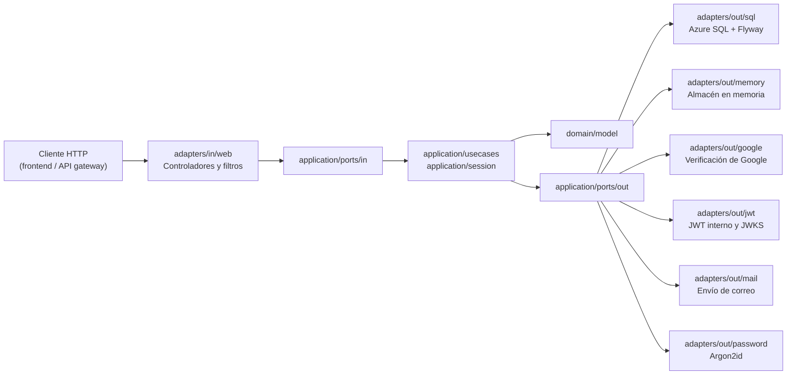

# ms-users

Microservicio de usuarios e identidad de **MarketTEC**, el marketplace universitario del Tecnológico de Costa Rica. Gestiona las cuentas, los perfiles y la autenticación de la comunidad, y emite el JWT interno que utilizan los demás servicios para identificar al usuario.

## Responsabilidades

- **Cuentas y perfiles.** Alta de usuarios, consulta y edición del perfil propio y consulta de perfiles por identificador.
- **Autenticación con Google.** Verifica el ID token de Google (firma, emisor, audiencia y vigencia) y crea o recupera la cuenta asociada.
- **Correo institucional.** Inicio de sesión mediante enlace de un solo uso (*Magic Link*) enviado al correo institucional y comprobación de la propiedad del correo.
- **Contraseñas.** Inicio de sesión con correo institucional y contraseña, definición de la primera contraseña, cambio y recuperación. Las contraseñas se almacenan con Argon2id.
- **Sesiones.** Creación, renovación (*refresh*), registro de actividad y cierre de sesión, con cookies protegidas y verificación CSRF.
- **Tokens internos.** Emisión de JWT RS256 y publicación de las claves públicas en `/.well-known/jwks.json`, que otros servicios usan para validar al usuario.

## Arquitectura

El servicio sigue una **arquitectura hexagonal** (puertos y adaptadores) sobre Spring Boot. El dominio y los casos de uso son Java puro y no dependen de Spring; los adaptadores implementan los puertos y la capa `config` compone la aplicación según los perfiles y variables activos.



Las pruebas de ArchUnit verifican que las dependencias apunten hacia el dominio y que dominio y aplicación no importen Spring ni capas externas.

### Organización del código

```text
src/main/java/com/markettec/users/
├── domain/model/          # Entidades e invariantes: User, UserProfile, Email, ExternalIdentity…
├── application/
│   ├── ports/in/          # Puertos de entrada (casos de uso expuestos)
│   ├── ports/out/         # Puertos de salida (repositorios, verificadores, emisores de tokens)
│   ├── usecases/          # Servicios de usuario y operaciones protegidas
│   └── session/           # Sesiones, Google, Magic Link, contraseñas y pruebas recientes
├── adapters/
│   ├── in/web/            # Controladores REST, CORS, CSRF, correlación y límites de tasa
│   └── out/               # sql, memory, google, jwt, mail, password
└── config/                # Composición de beans por perfil y variables de entorno
src/main/resources/
├── application*.yml       # Configuración base y perfiles SQL
└── db/migration/          # Migraciones Flyway (V1…V14)
src/test/java/             # Pruebas unitarias, web y de arquitectura
src/sql-test/java/         # Pruebas contra SQL Server real (perfil Maven sql-integration)
```

### Rutas principales

| Ruta | Función |
|---|---|
| `GET /health` | Estado del proceso |
| `POST /v1/auth/google`, `POST /v1/auth/google/registrations` | Inicio de sesión y registro con Google |
| `POST /v1/auth/email/requests`, `POST /v1/auth/email/confirm` | Inicio de sesión con enlace al correo institucional |
| `POST /v1/auth/password/login`, `POST /v1/auth/password/recovery/requests` | Inicio de sesión con contraseña y recuperación |
| `GET /v1/auth/session`, `POST /v1/auth/refresh`, `POST /v1/auth/logout` | Consulta, renovación y cierre de sesión |
| `GET`, `PUT /v1/me/profile` | Perfil del usuario autenticado |
| `GET`, `POST /v1/me/auth-methods` | Consulta y vinculación de métodos de autenticación |
| `GET`, `POST`, `PUT /v1/me/password` | Estado, definición y cambio de contraseña |
| `GET`, `PUT /v1/usuarios/{userId}` | Consulta y edición de un perfil por identificador |
| `GET /.well-known/jwks.json` | Claves públicas del JWT interno |

Todas las rutas, salvo `/health`, se habilitan explícitamente mediante variables de entorno; con la configuración por defecto responden `404`.

## Tecnologías

| Componente | Versión |
|---|---|
| Java | 21 |
| Spring Boot (Web, JDBC, Actuator) | 3.5.16 |
| Maven Wrapper | 3.9.11 |
| Microsoft JDBC Driver para SQL Server (`mssql-jdbc`) | gestionado por Spring Boot |
| Flyway (`flyway-core`, `flyway-sqlserver`) | gestionado por Spring Boot |
| Azure Identity | 1.15.3 |
| Nimbus JOSE + JWT | 10.10 |
| Spring Security Crypto + Bouncy Castle (Argon2id) | Bouncy Castle 1.80 |
| JUnit 5, Mockito, ArchUnit | ArchUnit 1.4.1 |
| Testcontainers (SQL Server) | solo en el perfil Maven `sql-integration` |

## Requisitos previos

- **JDK 21**. No se necesita Maven instalado: el repositorio incluye el wrapper `./mvnw`.
- Git.
- Para los perfiles SQL: Azure CLI con una sesión iniciada (`az login`) y acceso a una base de datos Azure SQL.
- Para las pruebas de integración SQL: Docker con un motor Linux x86-64.

## Instalación

```bash
git clone https://github.com/a-calderon-org/ms-users-market-tec.git
cd ms-users-market-tec
java -version
./mvnw --batch-mode dependency:go-offline
```

## Configuración local

Spring lee la configuración desde variables de entorno. El archivo [`.env.example`](.env.example) sirve como referencia, pero Spring no lo carga de forma automática: exporta las variables en la terminal. No guardes secretos en el repositorio.

### Perfiles

| Perfil (`SPRING_PROFILES_ACTIVE`) | Persistencia | Uso |
|---|---|---|
| `local` | En memoria; los datos se pierden al detener el proceso | Desarrollo sin base de datos |
| `sql-dev` | Azure SQL con la identidad de Azure CLI (`ActiveDirectoryDefault`) | Desarrollo contra una base real |
| `sql-appservice` | Azure SQL con identidad administrada | Ejecución en Azure |

Los perfiles SQL **no ejecutan migraciones**: al arrancar validan que el esquema y el historial de Flyway coincidan con las migraciones del código.

### Variables principales

| Variable | Descripción |
|---|---|
| `PORT`, `SERVICE_NAME` | Puerto HTTP (8080) y nombre del servicio |
| `MANAGEMENT_PORT` | Puerto de Actuator, solo en `127.0.0.1` (9091) |
| `USERS_SQL_SERVER`, `USERS_SQL_DATABASE`, `USERS_SQL_PORT`, `USERS_SQL_POOL_SIZE` | Conexión a Azure SQL (perfiles `sql-*`) |
| `USERS_INTERNAL_JWT_ENABLED`, `USERS_INTERNAL_JWT_ISSUER`, `USERS_INTERNAL_JWT_AUDIENCE` | Emisión del JWT interno |
| `USERS_INTERNAL_JWT_ACTIVE_KID`, `USERS_INTERNAL_JWT_KEYS_JSON` | Clave privada RSA activa (secreto) |
| `USERS_CSRF_ACTIVE_KID`, `USERS_CSRF_KEYS_JSON` | Claves de los tokens CSRF (secreto) |
| `USERS_GOOGLE_VERIFIER_ENABLED`, `USERS_GOOGLE_LOGIN_ENABLED`, `USERS_GOOGLE_REGISTRATION_ENABLED` | Activación del flujo de Google |
| `USERS_GOOGLE_AUDIENCES`, `USERS_GOOGLE_LOGIN_AUDIENCE` | Client ID de Google OAuth del entorno |
| `USERS_SESSION_HTTP_ENABLED`, `USERS_SESSION_REFRESH_ENABLED`, `USERS_SESSION_LOGOUT_ENABLED` | Rutas de sesión |
| `USERS_GOOGLE_HTTP_ALLOWED_ORIGINS`, `USERS_SESSION_HTTP_ALLOWED_ORIGINS` | Orígenes HTTPS permitidos para el navegador |
| `USERS_API_HTTP_ENABLED`, `USERS_API_HTTP_ALLOWED_ORIGINS` | API protegida de perfil |
| `USERS_EMAIL_ENABLED`, `USERS_EMAIL_PROVIDER`, `USERS_EMAIL_PROVIDER_ENDPOINT`, `USERS_EMAIL_FROM` | Envío de correos: `acs` (Azure Communication Services Email) o `resend` |
| `USERS_EMAIL_PROVIDER_API_KEY` | Clave del proveedor; solo con `resend` (secreto) |
| `USERS_EMAIL_LOGIN_LINK_BASE_URL`, `USERS_EMAIL_PROOF_LINK_BASE_URL`, `USERS_EMAIL_RECOVERY_LINK_BASE_URL` | Páginas del frontend que reciben los enlaces |
| `USERS_PASSWORD_ENABLED` | Autenticación con contraseña |

La lista completa y sus valores por defecto están en `src/main/resources/application.yml`.

## Ejecución local

Sin base de datos, con el perfil en memoria:

```bash
./mvnw spring-boot:run -Dspring-boot.run.profiles=local
curl -i http://localhost:8080/health
```

Contra una base Azure SQL ya migrada, con la sesión de Azure CLI:

```bash
az login
export USERS_SQL_SERVER=<servidor-azure-sql>
export USERS_SQL_DATABASE=<base-de-datos>
./mvnw spring-boot:run -Dspring-boot.run.profiles=sql-dev
```

## Compilación

```bash
./mvnw --batch-mode package
java -jar target/ms-users-0.1.0-SNAPSHOT.jar --spring.profiles.active=local
```

El repositorio incluye un `Dockerfile` multietapa (Eclipse Temurin 21) para construir la imagen del contenedor:

```bash
docker build -t ms-users .
docker run --rm -p 8080:8080 -e SPRING_PROFILES_ACTIVE=local ms-users
```

## Pruebas

```bash
# Pruebas unitarias, web y de arquitectura
./mvnw --batch-mode verify

# Pruebas contra un contenedor SQL Server efímero
# (requiere Docker x86-64 y aceptar la licencia de SQL Server Developer)
MTEC35_SQLSERVER_ACCEPT_EULA=Y bash scripts/qa-mtec35-sql.sh
```

## Persistencia

La persistencia usa **Spring JDBC** sobre **Azure SQL Database**. Las tablas de usuarios, perfiles, identidades externas, sesiones, intentos de autenticación y credenciales se definen en las migraciones Flyway de `src/main/resources/db/migration`. La conexión se autentica con Microsoft Entra ID: identidad de Azure CLI en desarrollo e identidad administrada en Azure; el servicio no usa usuarios ni contraseñas SQL.

Las migraciones no se aplican al arrancar. Se ejecutan de forma explícita con el punto de entrada `SqlMigrationRunner`, incluido en el JAR, que recibe un token de acceso de Microsoft Entra por la entrada estándar y solo admite `info` y `migrate --confirm-database=<USERS_SQL_DATABASE>`:

```bash
./mvnw --batch-mode -DskipTests package
JAR=target/ms-users-0.1.0-SNAPSHOT.jar
SQL_RESOURCE=<identificador-del-recurso-azure-sql>
az account get-access-token --resource "$SQL_RESOURCE" --query accessToken -o tsv |
  java -Dloader.main=com.markettec.users.adapters.out.sql.SqlMigrationRunner \
    -cp "$JAR" org.springframework.boot.loader.launch.PropertiesLauncher info
```

`SQL_RESOURCE` es el identificador de recurso de Azure SQL para tokens de Microsoft Entra, y `USERS_SQL_SERVER` y `USERS_SQL_DATABASE` deben estar exportadas. El runner no permite `clean`, `repair` ni `baseline`.

## Integraciones de autenticación

- **Google Identity.** Valida ID tokens con las claves públicas de Google, que se almacenan en caché.
- **Correo.** Envía los enlaces de acceso y recuperación mediante Azure Communication Services Email, autenticado con la identidad administrada, o mediante Resend con clave de API.
- **Otros microservicios.** `ms-catalog` valida el JWT interno con las claves publicadas en `/.well-known/jwks.json` y consulta el perfil del vendedor en `/v1/me/profile`.
- **API gateway.** Puede recibir el JWT del usuario en la cabecera `X-MTEC-User-Authorization` cuando el gateway usa `Authorization` para su propia identidad (`USERS_GATEWAY_USER_TOKEN_RELOCATION_ENABLED`).
